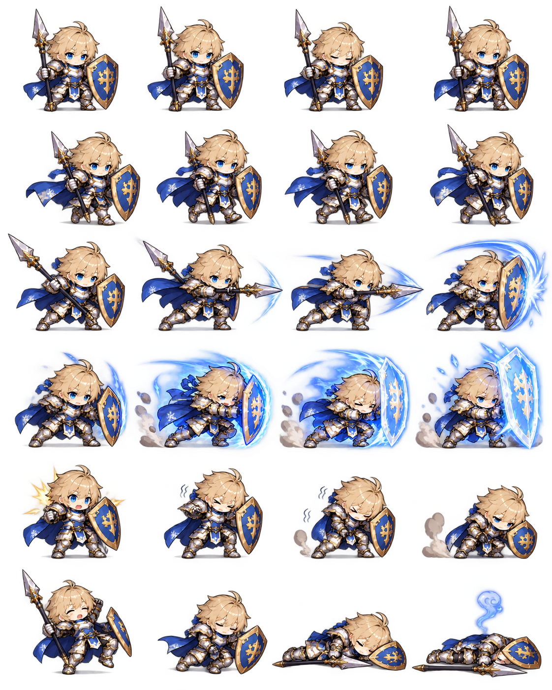

# Character

## 1. 캐릭터 등급

캐릭터의 태생 등급은 다음 4단계로 구성한다.

B → A → S → SS

- 등급은 캐릭터 최초 획득 시 결정되는 고유 등급이다.
- 캐릭터를 성장시켜도 태생 등급은 변경되지 않는다.
- 높은 등급일수록 기본 능력치, 기본 공격 성능, 일반 스킬 성능이 확실하게 높다.
- 하위 등급 캐릭터는 게임 진행에 따라 상위 등급 캐릭터로 교체되는 구조를 기본 방향으로 한다.
- 등급 배율은 B 1.0 / A 1.2 / S 1.45 / SS 1.8이다. (기본 능력치에 곱한다.)

## 2. 캐릭터 레벨

- 캐릭터 최초 획득 시 Lv.1부터 시작한다.
- 최대 레벨은 Lv.100이다.
- 레벨업 비용은 골드만 사용한다. 레벨 N → N+1에 `40 + 25 × N` 골드이다.
- 성장석은 사용하지 않는다.
- 레벨업을 통해 HP와 공격력이 상승한다. (별도의 방어력 능력치는 없고, 피해 감소는 스킬 효과로 표현한다.)
- 직업별로 능력치 성장 비율이 다르다. ([Combat.md](../04_Combat/Combat.md) 참고)

## 3. 기본 전투 구성

캐릭터의 전투 행동은 다음 두 가지를 기본으로 한다.

- 기본 공격
- 일반 스킬

궁극기 시스템은 사용하지 않는다.

일반 스킬은 쿨타임이 차면 자동으로 사용하며, 수동 모드에서는 유저가 직접 누른다.

## 4. 캐릭터 돌파

캐릭터 최초 획득 시 0돌파 상태로 시작한다.

☆☆☆☆☆

최대 5돌파까지 성장할 수 있다.

⭐☆☆☆☆
⭐⭐☆☆☆
⭐⭐⭐☆☆
⭐⭐⭐⭐☆
⭐⭐⭐⭐⭐

- 일반 레벨과 돌파는 서로 다른 성장 시스템이다.
- 돌파 1회에는 해당 캐릭터 조각 20개가 필요하다.
- 0돌파에서 5돌파까지 총 100개의 캐릭터 조각이 필요하다.
- 이미 보유한 동일 캐릭터를 다시 획득하면 해당 캐릭터의 조각을 획득한다.
- 중복 획득 시 등급과 관계없이 조각 20개를 받는다. (돌파 1회 분량)
- 캐릭터는 최대 4명, 한 직업당 1명만 편성할 수 있다.

## 5. 돌파 단계별 강화 방향

### ⭐ 1돌파

기본 능력치를 대폭 강화한다.

### ⭐⭐ 2돌파

기본 공격 성능을 강화한다.

캐릭터 특성에 따라 기본 공격 피해, 공격속도, 추가 효과 등으로 구성할 수 있다.

### ⭐⭐⭐ 3돌파

일반 스킬을 강화한다.

캐릭터의 핵심 스킬 효과가 한 단계 강화되는 구간으로 사용한다.

### ⭐⭐⭐⭐ 4돌파

기본 능력치를 추가로 크게 강화한다.

### ⭐⭐⭐⭐⭐ 5돌파

캐릭터의 고유 특성을 개방하거나 기존 특성을 크게 강화한다.

최종 돌파에 도달했을 때 해당 캐릭터의 특징이 가장 강하게 드러나도록 설계한다.

## 6. 돌파 효과 (확정)

| 단계 | 효과 |
|---|---|
| ⭐1 | HP·공격력 +20% |
| ⭐⭐2 | 기본 공격 피해 +20%, 공격 간격 -8% |
| ⭐⭐⭐3 | 일반 스킬 위력 +30% (아래 표의 3돌파 효과가 있으면 그 효과) |
| ⭐⭐⭐⭐4 | HP·공격력 +20% 추가 |
| ⭐⭐⭐⭐⭐5 | 스킬 쿨타임 -25% (아래 표의 5돌파 효과가 있으면 그 효과) |

## 7. 탱커 캐릭터

### 탱커 캐릭터 비주얼

#### 셀리온 전투 스프라이트 참고

셀리온의 중갑, 성검, 대형 방패와 빛의 결계 연출 방향을 반영한 2D 전투 스프라이트 시트이다.
전투에서는 idle, move, attack, skill, hit, death 프레임으로 분리해 사용하며, 세부 외형은 실제 제작 과정에서 조정할 수 있다.

### B 등급 - 카일

- 등급: B
- 직업: 탱커
- 컨셉: 자기 생존형 탱커
- 성격/외형 방향: 젊은 수비병 느낌. 성실하고 아직 성장 중인 캐릭터.
- 무기: 검 + 방패

#### 기본 공격

검으로 적을 공격한다.

#### 일반 스킬

일정 시간 자신이 받는 피해를 줄이고 보호막을 얻는다.

#### ⭐⭐⭐ 3돌파

일반 스킬 사용 시 자신의 HP를 일부 회복한다.

#### ⭐⭐⭐⭐⭐ 5돌파

일반 스킬 지속 중 받는 피해가 추가로 감소한다.

---

### A 등급 - 레이아

- 등급: A
- 직업: 탱커
- 컨셉: 아군 1인 보호형 탱커
- 성격/외형 방향: 책임감이 강하고 동료를 지키는 기사.
- 무기: 검 + 방패

#### 기본 공격

방패 또는 검으로 적을 공격한다.

#### 일반 스킬

현재 HP 비율이 가장 낮은 아군 1명에게 일정 시간 피해 감소 효과를 부여한다.

#### ⭐⭐⭐ 3돌파

보호 대상에게 추가로 보호막을 부여한다.

#### ⭐⭐⭐⭐⭐ 5돌파

보호 대상이 받는 피해의 일부를 레이아가 대신 받는다.

---

### S 등급 - 바르칸

- 등급: S
- 직업: 탱커
- 컨셉: 도발 및 적 약화형 탱커
- 성격/외형 방향: 무너진 성을 지켜온 과묵한 베테랑 수호자.
- 무기: 대형 무기 또는 대형 방패

#### 기본 공격

대형 무기로 적에게 강한 공격을 가한다.

#### 일반 스킬

주변 적을 도발하고 일정 시간 자신이 받는 피해를 감소시킨다.

#### ⭐⭐⭐ 3돌파

도발된 적에게 공격력 감소 효과를 추가로 부여한다.

#### ⭐⭐⭐⭐⭐ 5돌파

일반 스킬 지속 중 일정 횟수 이상 피격될 경우 주변 적에게 반격 피해를 준다.

---

### SS 등급 - 셀리온

- 등급: SS
- 직업: 탱커
- 컨셉: 파티 전체 보호형 최상위 탱커
- 성격/외형 방향: 빛을 잇는 고결한 수호기사.
- 무기: 성검 + 대형 방패

#### 기본 공격

성검으로 적을 공격한다.

#### 일반 스킬 - 빛의 결계

주변 적을 도발하고,
일정 시간 자신과 아군 전체가 받는 피해를 감소시킨다.

#### ⭐⭐⭐ 3돌파

일반 스킬 사용 시 셀리온 자신에게 추가 보호막을 부여한다.

#### ⭐⭐⭐⭐⭐ 5돌파

일반 스킬 사용 시 아군 전체에게 추가 보호막을 부여한다.

---

### 탱커 등급별 역할 방향

B → 자기 생존 중심
A → 특정 아군 보호
S → 적 도발 및 약화
SS → 파티 전체 보호

등급이 높아질수록 탱커가 보호할 수 있는 범위와 전투 영향력이 커지는 방향으로 설계한다.

## 8. 전체 캐릭터 목록 (20명)

직업 5종 × 등급 4종으로 총 20명이며, 직업당 B / A / S / SS 각 1명이다. 스킬 쿨타임은 초 단위이다.

### 탱커

| 등급 | 이름 | 스킬 | 쿨타임 | 효과 |
|---|---|---|---|---|
| B | 카일 | 수호의 자세 | 9 | 자신이 받는 피해를 줄이고 보호막을 얻는다. |
| A | 레이아 | 수호의 손길 | 9 | HP 비율이 가장 낮은 아군 1명에게 피해 감소를 부여한다. |
| S | 바르칸 | 철벽 도발 | 10 | 주변 적을 도발하고 받는 피해를 줄인다. |
| SS | 셀리온 | 빛의 결계 | 10 | 적을 도발하고 자신과 아군 전체의 피해를 줄이며 보호막을 부여한다. |

### 근접

| 등급 | 이름 | 스킬 | 쿨타임 | 효과 |
|---|---|---|---|---|
| B | 레온 | 강타 | 6 | 가장 앞의 적 1명에게 강력한 일격을 가한다. |
| A | 라이넬 | 회전 베기 | 6 | 모든 적을 공격하고 방어 게이지를 크게 깎는다. |
| S | 그람 | 피의 일격 | 7 | 가장 앞의 적에게 일격을 가하고 자신의 HP를 회복한다. 3돌파: 회복량 증가, 5돌파: 방어 게이지 피해 증가 |
| SS | 아르카 | 검기 폭풍 | 8 | 모든 적에게 검기를 날리고 방어 게이지를 크게 깎는다. |

### 원거리

| 등급 | 이름 | 스킬 | 쿨타임 | 효과 |
|---|---|---|---|---|
| B | 린 | 조준 사격 | 6.5 | 적 1명에게 강력한 화살을 쏜다. |
| A | 시에나 | 화살 폭풍 | 7 | 모든 적에게 화살 세 발을 쏜다. |
| S | 세라 | 저격 | 8 | 가장 후방의 적 1명에게 큰 피해를 준다. |
| SS | 미라 | 화염 폭발 | 7.5 | 모든 적에게 불꽃을 날려 피해를 준다. |

### 서포터

| 등급 | 이름 | 스킬 | 쿨타임 | 효과 |
|---|---|---|---|---|
| B | 미나 | 응급 치유 | 7 | HP 비율이 가장 낮은 아군 1명을 크게 회복한다. |
| A | 루트 | 전투의 노래 | 10 | 일정 시간 아군 전체의 공격력을 높인다. 3돌파: 지속 시간 증가, 5돌파: 증가량 추가 |
| S | 세레나 | 치유의 빛 | 8 | 아군 전체의 HP를 회복한다. |
| SS | 엘리아 | 성스러운 축복 | 9 | 아군 전체를 크게 회복하고 보호막을 부여한다. 3돌파: 보호막 증가, 5돌파: 회복량 증가 |

### 암살자

| 등급 | 이름 | 스킬 | 쿨타임 | 효과 |
|---|---|---|---|---|
| B | 렌 | 급소 찌르기 | 6 | 가장 후방의 적을 강하게 찌른다. |
| A | 벡스 | 독 단검 | 8 | 모든 적에게 독을 걸어 일정 시간 지속 피해를 준다. |
| S | 자이라 | 그림자 습격 | 6.5 | 가장 후방의 적을 습격해 3연속 베기를 가한다. |
| SS | 느와르 | 처형 | 8 | HP가 가장 낮은 적에게 치명적인 일격을 가한다. |

### 캐릭터 설계 방향

- 같은 등급 안에서도 직업마다 스킬 성격이 달라, 파티 구성에 따른 선택지를 만든다.
- 일부 캐릭터는 스프라이트가 직업 기본 외형의 색 변형이다. 캐릭터별 개성 강화는 남은 과제이다.
- 탱커는 B(자기 생존) → A(아군 1명 보호) → S(도발·적 약화) → SS(파티 전체 보호)로 역할 범위가 넓어진다.
