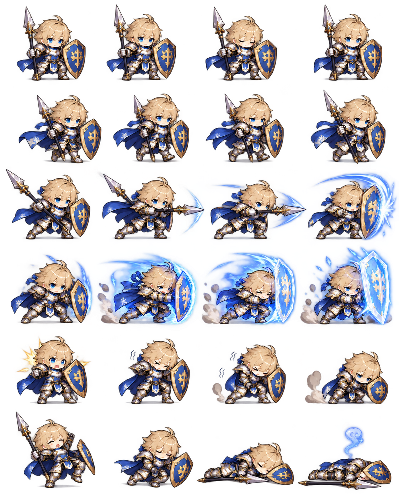

# Character

## 1. 캐릭터 등급

캐릭터의 태생 등급은 다음 4단계로 구성한다.

B → A → S → SS

- 등급은 캐릭터 최초 획득 시 결정되는 고유 등급이다.
- 캐릭터를 성장시켜도 태생 등급은 변경되지 않는다.
- 높은 등급일수록 기본 능력치, 기본 공격 성능, 일반 스킬 성능이 확실하게 높다.
- 하위 등급 캐릭터는 게임 진행에 따라 상위 등급 캐릭터로 교체되는 구조를 기본 방향으로 한다.
- 등급별 정확한 능력치 및 피해량 차이는 추후 Balance에서 결정한다.

## 2. 캐릭터 레벨

- 캐릭터 최초 획득 시 Lv.1부터 시작한다.
- 최대 레벨은 Lv.100이다.
- 레벨업을 통해 HP, 공격력, 방어력 등의 기본 능력치가 상승한다.
- 구체적인 경험치 요구량과 능력치 상승 수치는 추후 Balance에서 결정한다.

## 3. 기본 전투 구성

캐릭터의 전투 행동은 다음 두 가지를 기본으로 한다.

- 기본 공격
- 일반 스킬

궁극기 시스템은 사용하지 않는다.

일반 스킬은 전투 중 조건 또는 쿨타임에 따라 자동으로 사용한다.

## 4. 캐릭터 돌파

캐릭터 최초 획득 시 0돌파 상태로 시작한다.

☆☆☆☆☆

최대 5돌파까지 성장할 수 있다.

⭐☆☆☆☆
⭐⭐☆☆☆
⭐⭐⭐☆☆
⭐⭐⭐⭐☆
⭐⭐⭐⭐⭐

- 일반 레벨과 돌파는 서로 다른 성장 시스템이다.
- 돌파 1회에는 해당 캐릭터 조각 20개가 필요하다.
- 0돌파에서 5돌파까지 총 100개의 캐릭터 조각이 필요하다.
- 이미 보유한 동일 캐릭터를 다시 획득하면 해당 캐릭터의 조각을 획득한다.
- 중복 획득 시 지급되는 조각의 개수와 확률은 가챠 가격 및 확률을 설계한 뒤 기댓값을 계산하여 결정한다.

## 5. 돌파 단계별 강화 방향

### ⭐ 1돌파

기본 능력치를 대폭 강화한다.

### ⭐⭐ 2돌파

기본 공격 성능을 강화한다.

캐릭터 특성에 따라 기본 공격 피해, 공격속도, 추가 효과 등으로 구성할 수 있다.

### ⭐⭐⭐ 3돌파

일반 스킬을 강화한다.

캐릭터의 핵심 스킬 효과가 한 단계 강화되는 구간으로 사용한다.

### ⭐⭐⭐⭐ 4돌파

기본 능력치를 추가로 크게 강화한다.

### ⭐⭐⭐⭐⭐ 5돌파

캐릭터의 고유 특성을 개방하거나 기존 특성을 크게 강화한다.

최종 돌파에 도달했을 때 해당 캐릭터의 특징이 가장 강하게 드러나도록 설계한다.

## 6. 미확정 항목

다음 항목은 추후 관련 시스템 설계 시 확정한다.

- 등급별 정확한 기본 능력치 차이
- 등급별 기본 공격 및 스킬 피해 계수
- 레벨별 경험치 요구량
- 레벨별 능력치 증가량
- 중복 캐릭터 획득 시 조각 지급량 및 확률
- 돌파 단계별 정확한 능력치 증가 수치

## 7. 탱커 캐릭터 예시

### 탱커 캐릭터 비주얼

#### 셀리온 전투 스프라이트 참고

셀리온의 중갑, 성검, 대형 방패와 빛의 결계 연출 방향을 반영한 2D 전투 스프라이트 시트이다.
전투에서는 idle, move, attack, skill, hit, death 프레임으로 분리해 사용하며, 세부 외형은 실제 제작 과정에서 조정할 수 있다.

### B 등급 - 카일

- 등급: B
- 직업: 탱커
- 컨셉: 자기 생존형 탱커
- 성격/외형 방향: 젊은 수비병 느낌. 성실하고 아직 성장 중인 캐릭터.
- 무기: 검 + 방패

#### 기본 공격

검으로 적을 공격한다.

#### 일반 스킬

일정 시간 자신의 방어력을 증가시킨다.

#### ⭐⭐⭐ 3돌파

일반 스킬 사용 시 자신의 HP를 일부 회복한다.

#### ⭐⭐⭐⭐⭐ 5돌파

일반 스킬 지속 중 받는 피해가 추가로 감소한다.

---

### A 등급 - 레이아

- 등급: A
- 직업: 탱커
- 컨셉: 아군 1인 보호형 탱커
- 성격/외형 방향: 책임감이 강하고 동료를 지키는 기사.
- 무기: 검 + 방패

#### 기본 공격

방패 또는 검으로 적을 공격한다.

#### 일반 스킬

현재 HP 비율이 가장 낮은 아군 1명에게 일정 시간 피해 감소 효과를 부여한다.

#### ⭐⭐⭐ 3돌파

보호 대상에게 추가로 보호막을 부여한다.

#### ⭐⭐⭐⭐⭐ 5돌파

보호 대상이 받는 피해의 일부를 레이아가 대신 받는다.

---

### S 등급 - 바르칸

- 등급: S
- 직업: 탱커
- 컨셉: 도발 및 적 약화형 탱커
- 성격/외형 방향: 무너진 성을 지켜온 과묵한 베테랑 수호자.
- 무기: 대형 무기 또는 대형 방패

#### 기본 공격

대형 무기로 적에게 강한 공격을 가한다.

#### 일반 스킬

주변 적을 도발하고 일정 시간 자신이 받는 피해를 감소시킨다.

#### ⭐⭐⭐ 3돌파

도발된 적에게 공격력 감소 효과를 추가로 부여한다.

#### ⭐⭐⭐⭐⭐ 5돌파

일반 스킬 지속 중 일정 횟수 이상 피격될 경우 주변 적에게 반격 피해를 준다.

---

### SS 등급 - 셀리온

- 등급: SS
- 직업: 탱커
- 컨셉: 파티 전체 보호형 최상위 탱커
- 성격/외형 방향: 빛을 잇는 고결한 수호기사.
- 무기: 성검 + 대형 방패

#### 기본 공격

성검으로 적을 공격한다.

#### 일반 스킬 - 빛의 결계

주변 적을 도발하고,
일정 시간 자신과 아군 전체가 받는 피해를 감소시킨다.

#### ⭐⭐⭐ 3돌파

일반 스킬 사용 시 셀리온 자신에게 추가 보호막을 부여한다.

#### ⭐⭐⭐⭐⭐ 5돌파

일반 스킬 사용 시 아군 전체에게 추가 보호막을 부여한다.

---

### 탱커 등급별 역할 방향

B → 자기 생존 중심
A → 특정 아군 보호
S → 적 도발 및 약화
SS → 파티 전체 보호

등급이 높아질수록 탱커가 보호할 수 있는 범위와 전투 영향력이 커지는 방향으로 설계한다.
