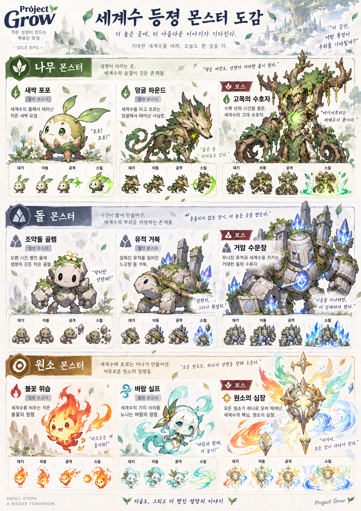

# Monster

## 몬스터 구분

몬스터는 별도 등급 없이 세 가지로 구분한다.

- 일반 몬스터
- 정예 몬스터: 3번째 웨이브부터 섞여 나오며, 일반 몬스터보다 HP 배율이 1.7배 높고, 크기도 약 18% 크다.
- 보스 몬스터: 보스 스테이지(N-5)의 마지막 웨이브에 단독으로 등장한다.

## 챕터별 몬스터

챕터마다 테마가 있고, 일반 몬스터 2종(약한 쪽, 단단한 쪽)과 보스 1종이 나온다. 정예는 단단한 쪽 몬스터가 강화되어 등장한다.

| 챕터 | 테마 | 약한 몬스터 | 단단한 몬스터 | 보스 |
|---|---|---|---|---|
| 1 세계수 숲 | 나무 | 새싹 포포 | 덩굴 하운드 | 고목의 수호자 |
| 2 독무 늪지 | 돌 | 조약돌 골렘 | 유적 거북 | 거암 수문장 |
| 3 불꽃 협곡 | 원소 | 불꽃 위습 | 바람 실프 | 원소의 심장 |

몬스터 도감 이미지는 위와 같고, 각 몬스터의 스프라이트 시트는 `Images/sprites/`에 있다.

### 몬스터 소개

- **새싹 포포 (나무):** 세계수의 품에서 태어난 작은 새싹 요정. 가장 약하고 수가 많다.
- **덩굴 하운드 (나무):** 세계수를 타고 흐르는 덩굴에서 태어난 사냥꾼. 빠르게 달려든다.
- **고목의 수호자 (나무 보스):** 수백 년의 시간을 품은 세계수의 고대 수호자.
- **조약돌 골렘 (돌):** 오랜 시간 쌓인 돌에 생명이 깃든 작은 골렘. 작지만 단단하다.
- **유적 거북 (돌):** 잊혀진 유적을 짊어진 느긋한 돌 거북. 느리지만 체력이 높다.
- **거암 수문장 (돌 보스):** 무너진 유적과 세계수를 지키는 거대한 돌의 수호자.
- **불꽃 위습 (원소):** 세계수를 비추는 작은 불꽃의 원령.
- **바람 실프 (원소):** 세계수의 가지 사이를 노니는 바람의 정령.
- **원소의 심장 (원소 보스):** 모든 원소가 하나로 모여 태어난, 세계수의 핵심.

### 기본 능력치 (스테이지 배율 적용 전)

| 몬스터 | HP | 공격력 | 공격 간격(초) |
|---|---|---|---|
| 새싹 포포 | 450 | 40 | 2.2 |
| 덩굴 하운드 | 900 | 58 | 1.9 |
| 고목의 수호자 (보스) | 7,000 | 100 | 2.6 |
| 조약돌 골렘 | 620 | 44 | 2.3 |
| 유적 거북 | 1,350 | 62 | 2.6 |
| 거암 수문장 (보스) | 8,500 | 110 | 2.5 |
| 불꽃 위습 | 560 | 52 | 2.0 |
| 바람 실프 | 1,200 | 62 | 1.6 |
| 원소의 심장 (보스) | 10,000 | 125 | 2.4 |

### 스테이지 배율

기본 능력치에 스테이지별 배율을 곱해 난이도를 올린다. HP는 배율 그대로, 공격력은 `1 + (배율 − 1) × 0.6`만 반영한다. 정예는 배율이 1.7배 더 붙는다.

| 스테이지 | 1 | 2 | 3 | 4 | 5 | 6 | 7 | 8 |
|---|---|---|---|---|---|---|---|---|
| 배율 | 0.3 | 0.42 | 0.8 | 1.2 | 1.7 | 2.4 | 2.9 | 3.4 |

| 스테이지 | 9 | 10 | 11 | 12 | 13 | 14 | 15 |
|---|---|---|---|---|---|---|---|
| 배율 | 3.9 | 4.5 | 5.2 | 6.0 | 6.8 | 7.7 | 8.7 |

## 보스 공통 패턴

- 기본 공격: 아군 1명을 공격한다.
- 대지 강타: 약 9초마다 파티 전체에 공격력의 80% 피해를 준다. 화면이 크게 흔들린다.
- 방어 게이지 100을 모두 잃으면 BREAK! GROGGY 상태가 되어 5초 동안 행동하지 못한다. ([Combat.md](../04_Combat/Combat.md) 참고)

## 몬스터 보상

몬스터 처치로 장비는 드랍되지 않는다. 처치 시 골드가 들어오고(약한 몬스터 45~50 / 단단한 몬스터 75~90 / 보스 750을 기준으로 스테이지에 비례), 일일 미션의 "몬스터 처치"에 집계된다.

## 추후 검토

- 몬스터별 고유 패턴 (덩굴로 전열 방해, 원거리 마법 공격 등)
- 비행 몬스터와 원거리 직업의 대응
- 보스 방어 태세와 방어 실패 강공격 패턴
- 보스마다 서로 다른 고유 패턴
- 초기 기획의 몬스터 설정(오염된 덩굴수, 세계수 갑각충 등)은 [archive](../archive/initial_planning/Monster.md)에 보관한다.
